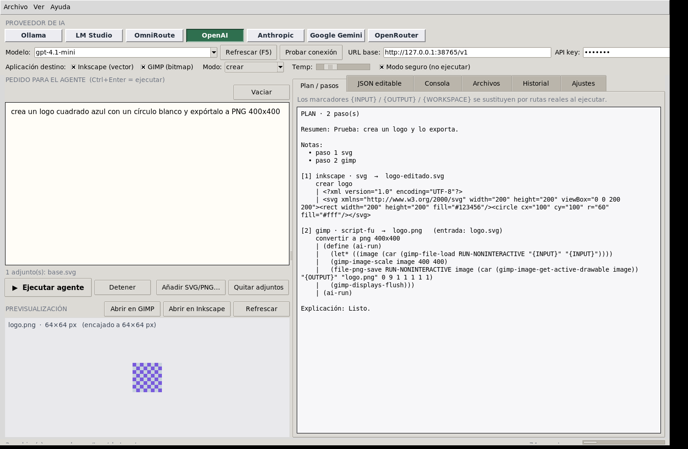

# AI Image Agent

Agente de IA que **crea y repara imágenes** usando **Inkscape** (vectores/SVG) y **GIMP**
(bitmaps), con el proveedor y el modelo que tú elijas: **OpenAI, Anthropic, Google Gemini,
Ollama, LM Studio, OpenRouter y OmniRoute** (local o nube).

El modelo no dibuja: **produce un plan JSON de pasos ejecutables** y el agente lo corre por
línea de órdenes contra tu Inkscape y tu GIMP instalados. Por eso el resultado es un SVG/PNG
real, editable, y no un cuadro de píxeles inventado. Si un paso falla, el agente devuelve el
error real al modelo y pide una corrección (bucle de reparación configurable).



---

## Índice

- [Qué hace](#qué-hace)
- [Requisitos](#requisitos)
- [Instalación en Windows](#instalación-en-windows)
- [Instalación en Debian 12 / 13](#instalación-en-debian-12--13)
- [Instalación como Flatpak](#instalación-como-flatpak)
- [Uso de la GUI](#uso-de-la-gui)
- [Proveedores y modelos](#proveedores-y-modelos)
- [Modo seguro (importante)](#modo-seguro-importante)
- [El plan: contrato JSON](#el-plan-contrato-json)
- [CLI sin GUI](#cli-sin-gui)
- [Compatibilidad GIMP 2.10 ↔ 3.x](#compatibilidad-gimp-210--3x)
- [Acciones de Inkscape](#acciones-de-inkscape)
- [Empaquetar tú mismo (.exe / .flatpak)](#empaquetar-tú-mismo-exe--flatpak)
- [Variables de entorno](#variables-de-entorno)
- [Pruebas](#pruebas)
- [Estructura del proyecto](#estructura-del-proyecto)
- [Problemas conocidos](#problemas-conocidos)
- [Licencia](#licencia)

---

## Qué hace

| Pedido                                           | Qué genera el agente                                                                                                                                                                      |
| ------------------------------------------------ | ----------------------------------------------------------------------------------------------------------------------------------------------------------------------------------------- |
| «Crea un logo minimalista de cafetería, redondo» | escribe `logo.svg` y lo exporta a `logo.png` con `inkscape --export-type=png`                                                                                                             |
| «Vectoriza este PNG»                             | Inkscape 1.4 **no** expone trazado por lotes: el agente lo dice, y propone `potrace`/`autotrace` como paso `shell-export` si están instalados (con `python-svg`+`inkex` como alternativa) |
| «Cambia el texto a “Panadería Lola”»             | paso `python-svg`: edita el SVG con `xml.etree.ElementTree`                                                                                                                               |
| «Redimensiona a 1080×1080 y marca agua»          | Script-Fu para GIMP (`gimp-image-scale`, capa de texto, `ai-save`)                                                                                                                        |
| «El PNG tiene fondo negro, ponlo transparente»   | Script-Fu + umbral/alpha                                                                                                                                                                  |
| «Esto salió mal, arrreglalo»                     | re-ejecuta con la consola de error como contexto (auto-reparación)                                                                                                                        |

Detalles verificados en este repo con **Inkscape 1.4** y **GIMP 3.0.4** reales
(`tests/test_real_tools.py`, 11 pruebas): exportado a PNG con tamaño exacto, `--actions` con
`export-dpi:150` → 375×250 px, ediciones ElementTree, script 2.10 ejecutándose en GIMP 3,
exportación a JPEG, y un GIMP colgado que el agente **mata** en vez de esperar para siempre.

## Requisitos

- **Python 3.9+** con **Tk 8.6** (`tkinter`). Solo usa librería estándar: no hace falta
  `pip install` para ejecutar la app (Pillow es opcional, solo para el generador de iconos
  y un escalado fino de la previsualización).
- **Inkscape 1.x** (para vectores) y/o **GIMP 2.10 o 3.x** (para bitmaps). La app **no los
  incluye**: los busca en el sistema (`PATH`, rutas típicas, `flatpak run`, `flatpak-spawn --host`).
- Windows 10/11 o **Debian 12 (bookworm)** / **Debian 13 (trixie)**. El `.exe` funciona en
  cualquier Windows de 64 bits sin Python instalado.

En Windows `py -3 -m tkinter` abre una ventanita de prueba; en Linux:
`python3 -m tkinter`. Si eso falla, te falta Tk.

## Instalación en Windows

### A. Binario `.exe` (sin Python)

1. Construye (o pide el `.exe` ya construido, ver [Empaquetar](#empaquetar-tú-mismo-exe--flatpak)):
   
   ```powershell
   git clone <tu-repo> aiimage-agent
   cd aiimage-agent
   .\packaging\windows\build_exe.ps1
   ```
   
   Resultado: `dist\AI-Image-Agent\AI-Image-Agent.exe`. Copia esa carpeta donde quieras
   (Escritorio, `C:\Program Files\...`); no necesita instalador ni Python.
2. Instala las apps destino (el instalador las detecta solas):
   
   ```powershell
   winget install -e --id Inkscape.Inkscape
   winget install -e --id GIMP.GIMP.3        # o GIMP.GIMP para la 2.10
   ```
3. Ejecuta `AI-Image-Agent.exe`.

> **PowerShell y CMD indistintamente**: `build_exe.ps1` y `build_exe.cmd` hacen lo mismo, y las
> rutas se construyen sin depender del separador. Para la CLI: `py -3 -m aiimage_agent --cli ...`
> (PowerShell) o `python -m aiimage_agent --cli ...` (CMD).

### B. Desde el código (desarrollo)

```powershell
py -3 .\run_agent.py            # abre la GUI
py -3 -m aiimage_agent --cli --tools
```

o, si quieres el comando `ai-image-agent` global:

```powershell
py -3 -m pip install .
ai-image-agent
```

## Instalación en Debian 12 / 13

```bash
git clone <tu-repo> aiimage-agent && cd aiimage-agent
sudo ./packaging/linux/install_debian.sh --deps      # solo apt: python3-tk inkscape gimp gimp-data
sudo ./packaging/linux/install_debian.sh             # copia a /usr/local + /usr/local/bin/ai-image-agent + menú
```

Opciones del script: `--user` (a `~/.local`, sin root), `--deps` (solo dependencias),
`--pyinstaller` (además genera `dist/AI-Image-Agent` con un venv de build),
`--test` (prueba de humo de la GUI, necesita X). Sin instalador, también vale:

```bash
python3 run_agent.py                                  # GUI
python3 -m aiimage_agent --cli --tools                # diagnóstico de herramientas
```

> En Debian **sin entorno gráfico** (VPS) la GUI no arranca; usa la CLI (`--cli`).
> Si quieres previsualizaciones PNG de los SVG, instala `inkscape` (se usa también para exportar).

## Instalación como Flatpak

```bash
sudo apt install -y flatpak flatpak-builder bubblewrap   # Debian 12/13
./packaging/flatpak/build_flatpak.sh                       # → dist/AI-Image-Agent.flatpak
flatpak install --user dist/AI-Image-Agent.flatpak
flatpak run com.arena.AiImageAgent
```

Qué hace ese manifiesto (`packaging/flatpak/com.arena.AiImageAgent.yml`):

- runtime `org.gnome.Platform//46` + **CPython 3.11 compilado con Tcl/Tk 8.6** (los runtimes
  Flatpak no traen Tkinter; se construyen `tcl` y `tk` como módulos y Python se configura
  con `--with-tcl/--with-tk`);
- **no** mete Inkscape/GIMP dentro: usa los del anfitrión vía `flatpak-spawn --host`
  (permiso `--talk-name=org.freedesktop.Flatpak`) o `flatpak run org.inkscape.Inkscape` /
  `org.gimp.GIMP` si los tienes como Flatpak — para eso `core/runner.py` antepone
  `flatpak-spawn --host` cuando detecta `FLATPAK_ID` (`AIA_NO_FLATPAK_SPAWN=1` lo desactiva);
- `--filesystem=home` (no `host`): el workspace vive en el home del usuario, así que Inkscape y GIMP
  del anfitrión ven los archivos sin darle a la app acceso al disco entero.

## Uso de la GUI

1. **Proveedor**: siete botones de selección (OpenAI, Anthropic, Gemini, Ollama, LM Studio,
   OpenRouter, OmniRoute). Al cambiarlos se refrescan **URL base**, **API key** y **modelo**.
2. **Modelo**: campo editable + desplegable. «Refrescar (F5)» pregunta la lista al proveedor
   (`/v1/models`, `/api/tags`, `models?key=`…); si el proveedor no responde se usan los modelos
   conocidos por defecto. «Probar conexión» hace una llamada mínima y dice OK/error real.
3. **App destino**: ☑ Inkscape (vector) / ☑ GIMP (bitmap), y **Modo**
   (crear · corregir · optimizar · vectorizar · analizar · exportar).
4. **Área de pedido**: cuadro de texto ancho (16 líneas) donde escribes lo que quieres con
   detalle. `Ctrl+Enter` = ejecutar. Botones **Añadir SVG/PNG…** para adjuntar el archivo a
   arreglar (su contenido se manda al modelo; los PNG se mandan como imagen si el proveedor
   lo soporta, si no se describe por texto).
5. **▶ Ejecutar agente** → pestaña **Plan / pasos** con cada paso legible y editable,
   pestaña **JSON editable** (cámbialo a mano y «Aplicar edición» / «Ejecutar solo este plan»),
   pestaña **Consola** con el comando real, stdout/stderr y tiempos, y
   pestaña **Archivos** con el explorador del workspace.
6. **Previsualización** a la derecha (PNG exportado por Inkscape), con
   «Abrir en Inkscape» / «Abrir en GIMP» para seguir a mano.
7. **Reparar con IA** (en la Consola) reenvía el error al modelo y genera un plan corregido.
8. **Historial**: últimas 40 peticiones, con «Repetir el pedido anterior».
9. **Ajustes**: temperature, `max_tokens`, timeout, TLS, auto-ejecución, previsualizaciones,
   rutas forzadas de `inkscape`/`gimp`/`python`, número de rondas de reparación, «Detectar
   herramientas» y «Guardar ajustes».

`~/.config/ai-image-agent/config.json` (Linux) o `%APPDATA%\AI Image Agent\config.json` (Windows).

## Proveedores y modelos

| Botón         | ID           | Base URL por defecto                               | Modelo por defecto    | API key              |
| ------------- | ------------ | -------------------------------------------------- | --------------------- | -------------------- |
| OpenAI        | `openai`     | `https://api.openai.com/v1`                        | `gpt-4.1-mini`        | `OPENAI_API_KEY`     |
| Anthropic     | `anthropic`  | `https://api.anthropic.com`                        | `claude-sonnet-4.5`   | `ANTHROPIC_API_KEY`  |
| Google Gemini | `gemini`     | `https://generativelanguage.googleapis.com/v1beta` | `gemini-2.5-flash`    | `GEMINI_API_KEY`     |
| Ollama        | `ollama`     | `http://localhost:11434`                           | `qwen2.5-coder:7b`    | no                   |
| LM Studio     | `lmstudio`   | `http://localhost:1234/v1`                         | `local-model`         | no                   |
| OpenRouter    | `openrouter` | `https://openrouter.ai/api/v1`                     | `openai/gpt-4.1-mini` | `OPENROUTER_API_KEY` |
| OmniRoute     | `omniroute`  | `http://localhost:20128/v1`                        | `auto`                | opcional             |

- Cada proveedor puede tener **su propia base URL y su propia key** guardadas en la config:
  cambias de nube a local sin perder nada.
- Ollama, LM Studio y OmniRoute no necesitan clave; admite cualquier endpoint compatible con
  OpenAI, así que `base_url` puede apuntar a vLLM, llama.cpp server, llama-swap, etc.
- OmniRoute es una pasarela local multi-proveedor (modelo `auto` para que elija él).
- Salida en JSON forzada cuando el proveedor lo soporta (`response_format`/`tool_use`); si no,
  el parser tolera JSON en un bloque ```...```, texto con llaves desbalanceadas y comas finales.
- **Transmisión en directo**: la respuesta se va imprimiendo en la Consola (SSE, NDJSON de
  Ollama y `streamGenerateContent` de Gemini).

## Modo seguro (importante)

El plan es **código generado por un modelo** que luego se ejecuta con tu Inkscape y tu GIMP.
Por eso el **Modo seguro va activado por defecto**:

- El agente **sí escribe** los archivos del plan (`svg`, `file`) y deja preparadas las órdenes
  de GIMP/Inkscape (`_ai_step.scm`, `_ai_step.py`), pero **no ejecuta nada**.
- La pestaña Consola te muestra exactamente qué se omitió y por qué.
- Para ejecutar: desmarca «Modo seguro (no ejecutar)» en la barra superior, o usa
  `--execute` en la CLI. En la GUI también puedes seleccionar un paso del plan y usar
  «Ejecutar en Inkscape» / «Ejecutar en GIMP».

Además, todo código que no sea un simple `svg`/`file` se analiza antes de correrse; se
**bloquean** (y se listan en la consola) estos tokens: `subprocess`, `os.system`, `os.popen`,
`os.exec`, `Popen`, `__import__`, `eval(`, `exec(`, `shutil.rmtree`, `os.remove`, `webbrowser`,
`socket`, `ctypes`, `winreg`, `os.environ`, `input(`, y `(gimp-quit` en Script-Fu (eso lo controla
el agente). «PERMITIR código con riesgo»
(en Ajustes / `--allow-unsafe`) los desbloquea bajo tu responsabilidad. Nunca se sobrescribe
el archivo de entrada: si el plan pide `input == output`, la salida se renombra
(`nombre-fix.ext`) y se avisa.

## El plan: contrato JSON

```json
{
  "summary": "qué se hará, 1-3 frases",
  "notes": ["advertencias o decisiones tomadas"],
  "workspace_files": [{ "name": "in.svg", "content": "..." }],
  "steps": [
    {
      "app": "inkscape",
      "kind": "svg",
      "purpose": "crear el logotipo base",
      "code": "<?xml version=\"1.0\" encoding=\"UTF-8\"?>\n<svg …>",
      "input": "",
      "output": "logo.svg"
    },
    {
      "app": "inkscape",
      "kind": "inkscape-actions",
      "purpose": "exportar a PNG a 300 dpi",
      "code": "export-area-drawing;\nexport-dpi:300;\nexport-background:#ffffff;",
      "input": "logo.svg",
      "output": "logo.png"
    }
  ],
  "explanation": "explicación para el usuario"
}
```

| `kind`             | App      | Cómo se ejecuta                                                                                 |
| ------------------ | -------- | ----------------------------------------------------------------------------------------------- |
| `svg`              | inkscape | se escribe el archivo (con validación de XML y `viewBox`)                                       |
| `inkscape-actions` | inkscape | `inkscape in.svg --actions "a;b;c" --batch-process --export-type png --export-filename out.png` |
| `python-svg`       | inkscape | `python3 _ai_step.py` con `WORKSPACE/INPUT/OUTPUT` inyectados (ElementTree)                     |
| `inkex-python`     | inkscape | igual, pero importando `inkex` (si tu Inkscape lo expone)                                       |
| `script-fu`        | gimp     | `gimp -i --batch-interpreter=plug-in-script-fu-eval -b '(load "_ai_step.scm")'`                 |
| `python-fu`        | gimp     | `--batch-interpreter=plug-in-python-eval` (3.x) / `python-fu-eval` (2.10)                       |
| `shell-export`     | ambas    | export/CLI libre, con la validación de seguridad                                                |
| `file`             | ambas    | volcar texto a un archivo del workspace                                                         |

Marcadores dentro del código: `{WORKSPACE}`, `{INPUT}` / `{INPUT_PATH}` / `{input}`,
`{OUTPUT}` / `{OUTPUT_PATH}` / `{output}` — se sustituyen por rutas absolutas (con `\\` doblado
en Windows) justo antes de ejecutar. En los pasos `python-svg` el agente escribe además las
constantes `WORKSPACE`, `INPUT`, `OUTPUT` en el preámbulo del script y hace `os.chdir(workspace)`.

## CLI sin GUI

```bash
# ver qué encontró la app y con qué versiones
python3 -m aiimage_agent --cli --tools

# generar y ejecutar un plan (nube)
python3 -m aiimage_agent --cli --provider openai --model gpt-4.1-mini \
    --prompt "logo de taller mecánico, vectorial, 512px" --app inkscape --execute -w ~/AIImageAgent

# solo el plan, sin ejecutar (JSON en stdout, para pipelines)
python3 -m aiimage_agent --cli --provider ollama --json --dry-run -p "…" --plan-out plan.json

# relanzar un plan ya revisado, sin volver a la IA
python3 -m aiimage_agent --cli --from-plan plan.json --execute -w ~/AIImageAgent

# corregir un archivo existente (se manda como contexto)
python3 -m aiimage_agent --cli -p "cambia el relleno a #0a7" -i logo.svg --mode corregir --execute
```

En PowerShell con comillas:

```powershell
py -3 -m aiimage_agent --cli --provider lmstudio --execute `
   --prompt "icono 256px de app de recetas, plano, sin degradados" --app inkscape
```

`--json` devuelve `{"ok":bool,"files":[...],"log":"...","plan":{...}}` y sale con 0/1,
suficiente para usar el agente desde un script de compilación o un action de CI.

## Compatibilidad GIMP 2.10 ↔ 3.x

Los PDBs de GIMP 2.10 y 3.x **no son compatibles** (`gimp-image-width` →
`gimp-image-get-width`, `gimp-image-get-active-drawable` desapareció, `file-png-save`
desapareció, `gimp-image-flatten` se comporta distinto, los accesores devuelven listas…).
En vez de obligarte a escribir dos veces cada script, `core/gimp_compat.py` **ante-pone un
preludio** al Script-Fu y lo ejecuta tal cual:

- define `(define (ai-load path) …)`, `(ai-save image path)`, `(ai-width image)`,
  `(ai-height image)`, `(ai-draw image)`, `(ai-flatten image)` y `ai-g3` (¿es GIMP 3+?);
- si el nombre no existe en tu versión, crea el **alias** con
  `(if (not (defined? 'gimp-image-get-active-drawable)) (define …))`, de modo que un script
  escrito «a lo 2.10» corre en 3.x (probado aquí: el script 2.10 de las pruebas se ejecuta en
  GIMP 3.0.4 y genera su PNG);
- si detecta llamadas que **no se pueden traducir con seguridad** (p. ej.
  `gimp-curves-spline`, `gimp-brightness-contrast`, que en 3.x pasan a nivel de drawable con
  otra firma), **advierte** en la consola en lugar de renombrar a ciegas;
- envuelve tu código en `(define (ai-run) …)(ai-run)` y quita `(gimp-quit 0)`: en GIMP 3 se
  pasa `--quit`, y si el proceso se cuelga el agente **lo mata** tras comprobar que no aparece
  el archivo de salida (con su prueba correspondiente).

El prompt del sistema enseña al modelo a usar los `ai-*`, así que lo normal es que el plan ya
nazca compatible con ambas versiones.

## Acciones de Inkscape

`inkscape-actions` se valida contra la salida de `inkscape --action-list` de **tu** instalación:

- las acciones inexistentes se **descartan con aviso** (y si todas eran inválidas el paso falla
  con un diagnóstico que lista acciones válidas → el bucle de reparación lo usa como contexto);
- se añade `--batch-process` automáticamente, porque en Inkscape 1.x **sin esa bandera las
  `--actions` se ignoran en silencio**;
- en Inkscape 1.4 hay **176** acciones (`inkscape --action-list`): `select-all`, `select-clear`,
  `select-invert`, `select-by-id`, `select-by-selector`, `delete-selection`, `duplicate`,
  `selection-group`, `selection-make-bitmap-copy`, `object-align[-on-canvas]`, `object-distribute`,
  `object-flip-*`, `object-rotate-90-ccw/cw`, `object-remove-overlaps`, `object-release-clip`,
  `object-stroke-to-path`, `object-set-attribute`, `path-union|difference|intersection|simplify`,
  `text-put-on-path`, `text-convert-to-glyphs`, `fit-canvas-to-selection`, `clone-unlink`,
  `file-open/new/close` y las `export-*` (`export-area-page`, `export-area-drawing`,
  `export-dpi:300`, `export-background:#ffffff`, `export-width`, `export-margin`,
  `export-text-to-path`…);
  **no** existen `edit-delete`, `item-remove`, `select-none` ni `trace-bitmap`;
- `export-type`, `export-filename` y `export-overwrite` **los controla el agente** a partir del
  campo `output` del paso; si el modelo los mete como acción, se ignoran con un aviso (así no hay
  dos destinos en la misma orden).
- sin GUI no hay selección real: `select-all`+`delete-selection` puede no aplicar cambios. Para
  eso el agente prefiere los pasos `svg`/`python-svg`, que son deterministas. Con el argumento
  `accion:valor` se admiten valores numéricos, `#hex` y rutas.

## Empaquetar tú mismo (.exe / .flatpak)

```bash
# Windows → dist\AI-Image-Agent\AI-Image-Agent.exe   (PowerShell o CMD, idéntico resultado)
.\packaging\windows\build_exe.ps1              # carpeta (recomendado)
.\packaging\windows\build_exe.ps1 -OneFile     # un único .exe autoextraíble
.\packaging\windows\build_exe.ps1 -SignThumbprint AAAA…   # firma con signtool si tienes certificado
packaging\windows\build_exe.cmd clean          # CMD, limpiando build/ y dist/

# Linux → dist/AI-Image-Agent.flatpak
./packaging/flatpak/build_flatpak.sh                        # valida, compila y exporta .flatpak
./packaging/flatpak/build_flatpak.sh --install                # y lo instala en el usuario
./packaging/flatpak/build_flatpak.sh --validate               # solo comprobar manifest + metainfo
./packaging/flatpak/build_flatpak.sh --from-tarball src.tar.xz # empaquetar desde un tarball (CI sin repo)

# iconos (vuelve a generar assets/ con Pillow)
python3 scripts/make_icon.py assets

# comprobar un binario ya empaquetado (usa el LLM simulado + las herramientas del equipo)
python3 scripts/frozen_smoke.py                 # o: python3 scripts/frozen_smoke.py --stubs
```

Notas del `.exe`:

- PyInstaller **no cruza de SO**: el `.exe` se construye en Windows (o en una VM/CI de Windows).
  En Linux el mismo `.spec` produce `dist/AI-Image-Agent/AI-Image-Agent`, que es lo que se
  comprueba aquí en CI.
- Se empaqueta como **carpeta** (`onedir`) por defecto: arranca más rápido y da menos avisos de
  antivirus que `--onefile`. El icono `.ico` (16·24·32·48·64·128·256 px) va incrustado en el EXE
  y en `assets/` para la ventana de Tk y el lanzador de escritorio.
- El binario **no** incluye Inkscape ni GIMP: son dependencias del sistema. Si quieres una
  instalación todo-en-uno en Windows, añade los instaladores con `install_tools.ps1`.

## Variables de entorno

| Variable                                                                      | Para qué                                                                                          |
| ----------------------------------------------------------------------------- | ------------------------------------------------------------------------------------------------- |
| `AIA_INKSCAPE` / `AIA_GIMP` / `AIA_PYTHON`                                    | fuerza el ejecutable (gana sobre `PATH` y sobre Ajustes); útil en pruebas o con Inkscape portable |
| `AIA_NO_FLATPAK_SPAWN=1`                                                      | dentro de Flatpak, desactiva `flatpak-spawn --host` y usa solo lo del sandbox                     |
| `AIIMAGE_AGENT_ASSETS`                                                        | carpeta de `assets/` alternativa (la usa el manifiesto de Flatpak)                                |
| `AIA_GUI_TMP`                                                                 | solo la sonda de GUI: carpeta donde monta sus stubs, su workspace y su config                     |
| `AIA_SCREENSHOT`                                                              | la sonda de GUI guarda ahí una captura de la ventana (para `assets/gui-screenshot.png`)           |
| `OPENAI_API_KEY`, `ANTHROPIC_API_KEY`, `GEMINI_API_KEY`, `OPENROUTER_API_KEY` | leídas automáticamente si el campo de la key está vacío                                           |

## Pruebas

```bash
python3 -W error::ResourceWarning -m unittest discover -s tests    # 60 pruebas
```

Todo con `unittest` del propio Python (sin pytest ni dependencias externas):

| Archivo                    | Qué cubre                                                                                                                                                                                                                                                                                                                         |
| -------------------------- | --------------------------------------------------------------------------------------------------------------------------------------------------------------------------------------------------------------------------------------------------------------------------------------------------------------------------------- |
| `tests/test_agent.py`      | 45: payload/headers de los 7 proveedores, streaming SSE/NDJSON, parser de planes (JSON roto, bloques ```json```, comas finales), red de `core/net.py` (reintentos, gzip, errores amigables), runner contra stubs de `inkscape`/`gimp` falsos, integración del agente + bucle de reparación, CLI de punta a punta en un subproceso |
| `tests/test_real_tools.py` | 11: **con Inkscape y GIMP reales** (`skipif` si no están): export SVG→PNG exacto, `--actions` con `export-dpi`, rechazo de acciones inválidas, `python-svg` + export PDF, Script-Fu `ai-*`, script 2.10 en GIMP 3, JPEG, reporte de errores, matar GIMP colgado, pipeline encadenado                                              |
| `tests/test_gui_smoke.py`  | 4: GUI real bajo **Xvfb** manejando `scripts/gui_probe.py` por subproceso (4 escenarios, 44 aserciones): flujo completo con LLM simulado, botones de proveedor, diálogo de error, modo seguro, icono, captura de pantalla                                                                                                         |

`tests/mock_llm.py` simula los 7 endpoints (incluidos `/api/tags` de Ollama,
`/v1/messages` de Anthropic y `streamGenerateContent` de Gemini) y `tests/tool_stubs.py`
genera binarios falsos de Inkscape/GIMP que aceptan las mismas banderas y **se quedan colgados
a propósito** para probar la ruta de timeout+kill. Para que las pruebas no se lleven tus
Inkscape/GIMP reales, el descubrimiento respeta `AIA_INKSCAPE`/`AIA_GIMP`.

## Estructura del proyecto

```
run_agent.py          entrada limpia para PyInstaller
aiimage_agent/
  app.py            GUI Tk (ttk): proveedores, modelo, área de pedido, plan/JSON/consola/archivos
  cli.py            interfaz de consola (--cli, --json, --from-plan, --tools…)
  core/
    agent.py        orquestación: pedir plan → ejecutar → reparar
    prompts.py      contrato JSON + reglas para Inkscape/GIMP
    plan.py         Parseo tolerante, validación, renombrado seguro, render legible
    runner.py       descubrimiento de herramientas, seguridad, ejecución, timeouts, kill
    gimp_compat.py  preludio Script-Fu 2.10 ↔ 3.x y detección de llamadas no traducibles
    net.py          HTTP con urllib (reintentos, SSE/NDJSON, gzip)
    config.py       configuración persistente (una entrada por proveedor)
    images.py       tamaño/formato de imagen sin Pillow
    resources.py    dónde están los assets (repo, _MEIPASS, _internal, Flatpak)
  providers/        7 proveedores sobre 4 dialectos de API
assets/             icon.ico (multi-res), icon.png, icon.svg, icon.icns, captura de la GUI
packaging/windows/  AIImageAgent.spec, build_exe.{ps1,cmd}, run_dev.{ps1,cmd}, install_tools.ps1
packaging/linux/    install_debian.sh, ai-image-agent.desktop
packaging/flatpak/  com.arena.AiImageAgent.yml, launcher, metainfo, build_flatpak.sh
scripts/            make_icon.py, gui_probe.py, frozen_smoke.py
tests/              56 pruebas (unittest)
```

## Problemas conocidos

- **Python-Fu** depende de que tu GIMP esté compilado con soporte Python. En Debian 12/13 con
  GIMP 3 hay que instalar `python3-gi` y el paquete de GIMP correspondiente; si falta, el paso
  `python-fu` falla con un diagnóstico que te dice que uses `script-fu` (que siempre funciona).
- **GIMP 3** requiere `gimp-console-3.0`/`gimp` en `PATH`; sin `DISPLAY` algunas operaciones de
  color emiten `Gtk-WARNING: cannot open display` pero no impiden exportar.
- El `.exe` se construye **en Windows** (PyInstaller no cross-compila); la carpeta `dist/` pesa
  ~30 MB y no incluye Tkinter → si tu Python no tenía Tk, el `.exe` tampoco lo tendrá.
- Las **extensiones** de GIMP (HEIF, WebP export) no están garantizadas: el agente pide PNG/JPEG
  cuando puede y lo avisa en `notes`.
- Sin red ni nube, con Ollama/LM Studio local: la calidad del plan depende del modelo local;
  `qwen2.5-coder:7b` o superior es lo recomendado.

## Licencia

MIT — ver [LICENSE](LICENSE).
